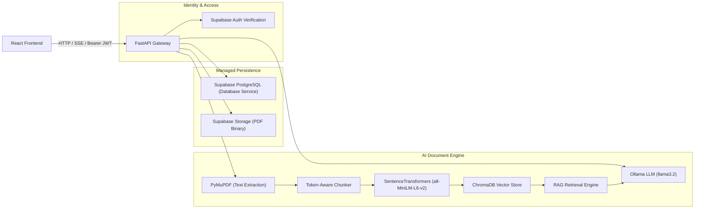

# Sophia AI — Backend Architecture

## Overview

The Sophia AI backend is an async FastAPI service that powers AI-assisted research paper synthesis and question answering. It integrates with **Supabase** for managed database storage, authentication, and file persistence, while leveraging local specialized models (SentenceTransformers, ChromaDB, Ollama) for privacy-preserving AI processing.

---

## 1. System Components

---

## 2. Request Lifecycle

1. **Authentication**:
   FastAPI receives `Authorization: Bearer <token>` on all `/api/v1/documents/*` endpoints. `get_current_user` validates the token with Supabase Auth and extracts the verified `user_id: UUID`.

2. **Ingestion & Upload**:
   - `POST /api/v1/documents`: Receives multipart PDF.
   - Text is extracted page-by-page preserving accurate page references.
   - PDF is saved to Supabase Storage: `research-papers/{user_id}/{document_id}/original.pdf`.
   - Metadata is created in `public.documents`.
   - Chunks are embedded and stored in ChromaDB isolated by `document_id`.

3. **Synthesis & Q&A**:
   - `POST /api/v1/documents/{id}/summary`: Generates structured academic sections with Ollama; cached in `public.summaries`.
   - `POST /api/v1/documents/{id}/questions`: Retrieves top matching chunks from ChromaDB, formats prompt with strict grounding instructions, returns response with exact page citations.
   - `GET /api/v1/documents/{id}/questions/stream`: Streams tokens via Server-Sent Events (SSE).

