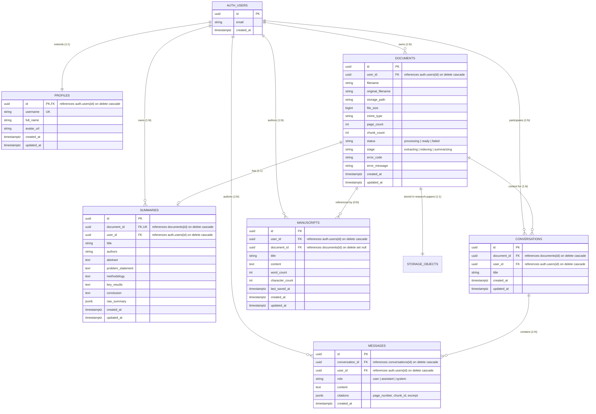

# Sophia AI — Supabase Database Architecture & Redesign

## 1. Architectural Blueprint & Principles

The Sophia AI database architecture integrates Supabase managed PostgreSQL, Supabase Auth, Supabase Storage, and local vector indexing (ChromaDB).



---

## 2. Hardened Security & RLS Matrix

Every table enforces Row-Level Security (`ALTER TABLE ... ENABLE ROW LEVEL SECURITY`). To prevent cross-tenant referencing, child record creation validates parent ownership via subquery constraints:

| Table | Operation | Security Policy Logic |
|---|---|---|
| **`profiles`** | SELECT / UPDATE / DELETE | `auth.uid() = id` |
| | INSERT | `auth.uid() = id` (or system definer trigger) |
| **`documents`** | ALL | `auth.uid() = user_id` |
| **`summaries`** | SELECT / UPDATE / DELETE | `auth.uid() = user_id` |
| | INSERT | `auth.uid() = user_id AND EXISTS (SELECT 1 FROM public.documents d WHERE d.id = document_id AND d.user_id = auth.uid())` |
| **`conversations`**| SELECT / UPDATE / DELETE | `auth.uid() = user_id` |
| | INSERT | `auth.uid() = user_id AND EXISTS (SELECT 1 FROM public.documents d WHERE d.id = document_id AND d.user_id = auth.uid())` |
| **`messages`** | SELECT / DELETE | `auth.uid() = user_id` |
| | INSERT | `auth.uid() = user_id AND EXISTS (SELECT 1 FROM public.conversations c WHERE c.id = conversation_id AND c.user_id = auth.uid())` |
| **`manuscripts`** | SELECT / DELETE | `auth.uid() = user_id` |
| | INSERT / UPDATE | `auth.uid() = user_id AND (document_id IS NULL OR EXISTS (SELECT 1 FROM public.documents d WHERE d.id = document_id AND d.user_id = auth.uid()))` |
| **`storage.objects`**| SELECT / INSERT / UPDATE / DELETE | `bucket_id = 'research-papers' AND (storage.foldername(name))[1] = auth.uid()::TEXT` |

---

## 3. Database Triggers & Automations

### 3.1 User Provisioning (`handle_new_user`)
Runs `AFTER INSERT ON auth.users`. Automatically creates a row in `public.profiles` using the user's metadata or email prefix.

### 3.2 Automated `updated_at` Maintenance
Runs `BEFORE UPDATE` on `profiles`, `documents`, `summaries`, `conversations`, and `manuscripts`.
```sql
CREATE OR REPLACE FUNCTION public.set_updated_at()
RETURNS TRIGGER
LANGUAGE plpgsql
AS $$
BEGIN
    NEW.updated_at = now();
    RETURN NEW;
END;
$$;
```

---

## 4. Indexing Strategy

```sql
-- Fast username queries
CREATE INDEX IF NOT EXISTS ix_profiles_username ON public.profiles(username);

-- User documents list ordered by creation date
CREATE INDEX IF NOT EXISTS ix_documents_user_id ON public.documents(user_id);
CREATE INDEX IF NOT EXISTS ix_documents_created_at ON public.documents(created_at DESC);
CREATE INDEX IF NOT EXISTS ix_documents_status ON public.documents(status);

-- 1:1 summary lookup
CREATE INDEX IF NOT EXISTS ix_summaries_document_id ON public.summaries(document_id);
CREATE INDEX IF NOT EXISTS ix_summaries_user_id ON public.summaries(user_id);

-- Conversation and message history
CREATE INDEX IF NOT EXISTS ix_conversations_user_id ON public.conversations(user_id);
CREATE INDEX IF NOT EXISTS ix_conversations_document_id ON public.conversations(document_id);
CREATE INDEX IF NOT EXISTS ix_messages_conversation_id ON public.messages(conversation_id);
CREATE INDEX IF NOT EXISTS ix_messages_created_at ON public.messages(created_at ASC);

-- Manuscript listing and recent drafts
CREATE INDEX IF NOT EXISTS ix_manuscripts_user_id ON public.manuscripts(user_id);
CREATE INDEX IF NOT EXISTS ix_manuscripts_updated_at ON public.manuscripts(updated_at DESC);
```

