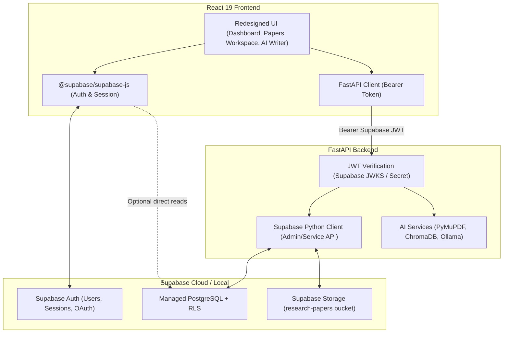

# Sophia AI — Supabase Migration Audit

## 1. Executive Summary

This audit assesses the migration of Sophia AI from its custom local database and authentication stack (PostgreSQL + SQLAlchemy 2.0 + Alembic + custom RS256 JWT auth + local filesystem PDF storage) to a managed **Supabase** backend (Supabase Auth, Supabase PostgreSQL with Row Level Security, and Supabase Storage).

The redesigned React 19 + Tailwind CSS v4 frontend and the core AI processing pipeline (PyMuPDF, SentenceTransformers, ChromaDB vector store, Ollama LLM) will be fully preserved.

---

## 2. Current Architecture & Dependencies

### 2.1 Backend Database & ORM
- **Engine**: SQLAlchemy 2.0 async engine (`create_async_engine`) using `asyncpg`.
- **Session Management**: Custom `Database` singleton in `backend/app/db/session.py`.
- **Migrations**: Alembic versioning in `backend/alembic/versions/` (`a23104b63ed9_initial_schema.py`).
- **Models**:
  - `User` (`backend/app/models/user.py`): id, username, email, password_hash, full_name, avatar_url, is_active, is_verified, created_at, updated_at, last_login_at.
  - `OAuthAccount`: id, user_id, provider, provider_user_id, access_token, refresh_token, expires_at, created_at.
  - `PasswordResetToken`: id, user_id, token_hash, expires_at, used_at, created_at.
  - `EmailVerificationToken`: id, user_id, token_hash, expires_at, used_at, created_at.
  - `Document` (`backend/app/models/document.py`): id, user_id, filename, page_count, chunk_count, status, stage, error_code, error_message, summary (JSON text), created_at, updated_at.

### 2.2 Backend Authentication
- **Mechanism**: Custom stateless RS256 JWT tokens with local keypair (`keys/private.pem`, `keys/public.pem`).
- **Password Hashing**: Argon2id via `argon2-cffi`.
- **OAuth**: Custom Google OAuth code exchange endpoint in `backend/app/services/auth.py`.
- **Token Verification**: In `backend/app/dependencies.py`: `get_current_user` decodes RS256 tokens and validates against `users` table via SQLAlchemy.

### 2.3 Document Storage
- **Current Storage**: Filesystem-based: `data/documents/{document_id}/original.pdf`.
- **Serving**: `GET /api/v1/documents/{document_id}/file` streams the file from disk using FastAPI `FileResponse`.

### 2.4 AI Pipeline
- **Extraction**: `extract_pages` in `backend/app/infrastructure/pdf.py` using PyMuPDF (`fitz`).
- **Chunking**: `chunk_pages` in `backend/app/infrastructure/chunking.py`.
- **Embeddings**: SentenceTransformers `all-MiniLM-L6-v2`.
- **Vector Store**: Local ChromaDB persistent client at `data/chroma`.
- **Summarization**: Ollama LLM (`llama3.2`) generating structured JSON (title, authors, abstract, problem_statement, methodology, key_results, conclusion).
- **RAG Q&A**: ChromaDB vector retrieval + Ollama prompt synthesis with cited page chunks.

### 2.5 Frontend
- **Framework**: React 19, Vite, TypeScript, Tailwind CSS v4.
- **State & Auth**: `frontend/src/contexts/AuthContext.tsx` storing access tokens in memory and calling custom `/api/v1/auth/*` endpoints.
- **API Client**: `frontend/src/api/client.ts` injecting `Authorization: Bearer <token>` into fetch requests.
- **Pages**: Dashboard, My Papers, Research Workspace, AI Writer, Login, Register, Forgot Password, Reset Password, Google Callback.

---

## 3. Target Supabase Architecture



---

## 4. Database Schema Design & Mapping

### 4.1 Schema Overview

| Target Supabase Table | Replaces | Key Columns | Primary / Foreign Keys |
|---|---|---|---|
| `public.profiles` | `users` (metadata part) | `id`, `username`, `full_name`, `avatar_url`, `created_at`, `updated_at` | `id REFERENCES auth.users(id) ON DELETE CASCADE` |
| `public.documents` | `documents` | `id`, `user_id`, `filename`, `original_filename`, `storage_path`, `file_size`, `mime_type`, `page_count`, `chunk_count`, `status`, `stage`, `error_code`, `error_message`, `created_at`, `updated_at` | `id PRIMARY KEY UUID`, `user_id REFERENCES auth.users(id) ON DELETE CASCADE` |
| `public.summaries` | `documents.summary` | `id`, `document_id`, `user_id`, `title`, `authors`, `abstract`, `problem_statement`, `methodology`, `key_results`, `conclusion`, `raw_summary`, `created_at`, `updated_at` | `id PRIMARY KEY UUID`, `document_id REFERENCES documents(id) ON DELETE CASCADE`, `user_id REFERENCES auth.users(id) ON DELETE CASCADE` |
| `public.conversations` | (New persistent chat) | `id`, `document_id`, `user_id`, `title`, `created_at`, `updated_at` | `id PRIMARY KEY UUID`, `document_id REFERENCES documents(id) ON DELETE CASCADE`, `user_id REFERENCES auth.users(id) ON DELETE CASCADE` |
| `public.messages` | (New persistent chat) | `id`, `conversation_id`, `user_id`, `role`, `content`, `citations`, `created_at` | `id PRIMARY KEY UUID`, `conversation_id REFERENCES conversations(id) ON DELETE CASCADE`, `user_id REFERENCES auth.users(id) ON DELETE CASCADE` |
| `public.manuscripts` | (New AI Writer drafts) | `id`, `user_id`, `title`, `content`, `word_count`, `character_count`, `last_saved_at`, `created_at`, `updated_at` | `id PRIMARY KEY UUID`, `user_id REFERENCES auth.users(id) ON DELETE CASCADE` |

*Note*: `oauth_accounts`, `password_reset_tokens`, and `email_verification_tokens` are natively managed by Supabase Auth (`auth.users`, `auth.identities`) and do not require custom application tables.

---

## 5. Row Level Security (RLS) Strategy

All application tables will have `ROW LEVEL SECURITY` enabled:

1. **`public.profiles`**:
   - `SELECT`: `true` (authenticated users can read public profiles) OR `auth.uid() = id`.
   - `INSERT`: `auth.uid() = id`.
   - `UPDATE`: `auth.uid() = id` (WITH CHECK `auth.uid() = id`).
   - `DELETE`: `auth.uid() = id`.

2. **`public.documents`**:
   - `SELECT`: `auth.uid() = user_id`.
   - `INSERT`: `auth.uid() = user_id`.
   - `UPDATE`: `auth.uid() = user_id` (WITH CHECK `auth.uid() = user_id`).
   - `DELETE`: `auth.uid() = user_id`.

3. **`public.summaries`**, **`public.conversations`**, **`public.messages`**, **`public.manuscripts`**:
   - Strict `auth.uid() = user_id` for all operations.

4. **Supabase Storage (`research-papers` bucket)**:
   - Private bucket.
   - Path format: `{user_id}/{document_id}/original.pdf`.
   - Storage RLS Policy:
     - `SELECT`: `bucket_id = 'research-papers' AND (storage.foldername(name))[1] = auth.uid()::text`
     - `INSERT`: `bucket_id = 'research-papers' AND (storage.foldername(name))[1] = auth.uid()::text`
     - `DELETE`: `bucket_id = 'research-papers' AND (storage.foldername(name))[1] = auth.uid()::text`

---

## 6. Authentication Migration Strategy

1. **Frontend**:
   - Add `@supabase/supabase-js`.
   - Initialize Supabase client in `frontend/src/lib/supabase.ts` using `VITE_SUPABASE_URL` and `VITE_SUPABASE_PUBLISHABLE_KEY` (or `VITE_SUPABASE_ANON_KEY`).
   - Replace internal `doLogin`, `doRegister`, `doLogout` in `AuthContext` with `supabase.auth.signInWithPassword`, `supabase.auth.signUp`, `supabase.auth.signOut`.
   - Wire `supabase.auth.onAuthStateChange` to synchronize auth tokens in memory (`setAuthToken(session?.access_token)`).

2. **Backend**:
   - Install `supabase` and `pyjwt` (or use existing `python-jose` / `jwt`) for token verification.
   - Update `backend/app/dependencies.py` to validate the Supabase JWT.
   - Supabase tokens contain:
     - `sub`: The UUID of the user in `auth.users`.
     - `aud`: `authenticated`.
     - `iss`: `https://<project-ref>.supabase.co/auth/v1`.
     - `exp`: Expiration epoch timestamp.
   - Verification validates the signature (via Supabase secret or JWKS endpoint) and checks `sub`, providing the authenticated `user_id: UUID` to all FastAPI endpoints.

---

## 7. Database & Storage Client Migration

1. **`app/core/supabase.py`**:
   - Create a clean helper initializing the Supabase client:
     ```python
     from supabase import create_client, Client
     # Service client for trusted backend tasks:
     supabase_client = create_client(settings.supabase_url, settings.supabase_secret_key)
     ```
2. **Replacing SQLAlchemy**:
   - Migrate document ingestion, querying, and deletion from `select(DocumentModel)` to Supabase Python client calls:
     - `supabase.table("documents").insert(...)`
     - `supabase.table("documents").select("*").eq("user_id", str(user_id))`
     - `supabase.table("summaries").select("*").eq("document_id", str(document_id))`
3. **Storage Integration**:
   - Upload PDF binary to Supabase Storage:
     - `supabase.storage.from_("research-papers").upload(path, data, file_options={"content-type": "application/pdf"})`
   - Download PDF binary:
     - `supabase.storage.from_("research-papers").download(path)`
   - Delete PDF object:
     - `supabase.storage.from_("research-papers").remove([path])`

---

## 8. Data Migration & Compatibility Requirements

- **Existing Data**: The project is in active development with local development-only files in `data/documents/` and no persistent external PostgreSQL production instances. New Supabase instance will start clean.
- **Zero API Contract Breakage**:
  - `POST /api/v1/documents`
  - `GET /api/v1/documents`
  - `GET /api/v1/documents/{id}`
  - `DELETE /api/v1/documents/{id}`
  - `GET /api/v1/documents/{id}/file`
  - `POST /api/v1/documents/{id}/summary`
  - `GET /api/v1/documents/{id}/summary`
  - `POST /api/v1/documents/{id}/questions`
  - `GET /api/v1/documents/{id}/questions/stream`
  All these endpoints keep identical paths, request schemas, and response schemas.

---

## 9. Security Risks & Mitigations

| Risk | Mitigation |
|---|---|
| Exposure of Supabase Secret Key | Secret key is stored ONLY in `backend/.env` as `SUPABASE_SECRET_KEY` and NEVER prefixed with `VITE_` or included in frontend bundles. |
| Insecure Token Storage | Supabase tokens are handled via standard Supabase auth flow; FastAPI token header remains `Authorization: Bearer <token>`. |
| Cross-User Access | Both Supabase RLS and backend endpoint authorization enforce `auth.uid() = user_id`. |
| Broken Database Imports | SQLAlchemy and Alembic will remain untouched until Supabase services and tests are completely verified. |

---

## 10. Migration Phase Sequence

1. **Phase 1: Supabase Configuration & Dependencies** (Add `@supabase/supabase-js`, `supabase` Python package, update `.env.example`).
2. **Phase 2: Supabase Schema & SQL Migrations** (Create SQL scripts for `profiles`, `documents`, `summaries`, `conversations`, `messages`, `manuscripts`).
3. **Phase 3: Row Level Security Policies** (Create SQL scripts for RLS on all tables and storage).
4. **Phase 4: Supabase Auth** (Implement token verification in FastAPI backend and Supabase Auth in React frontend).
5. **Phase 5: Supabase Python Client** (`app/core/supabase.py` for database operations).
6. **Phase 6: Supabase Storage Integration** (Replace local file writes with `research-papers` storage bucket).
7. **Phase 7: AI Document Pipeline Preservation** (Verify PyMuPDF, SentenceTransformers, ChromaDB, and Ollama integration with Supabase).
8. **Phase 8: Frontend Integration** (Connect React auth, document listing, uploading, workspace, and writer to Supabase).
9. **Phase 9: Data & End-to-End Verification**.
10. **Phase 10: Legacy Cleanup** (Safely retire SQLAlchemy and Alembic once verified).
11. **Phase 11: Testing & QA** (Run backend test suite and frontend test suite).
12. **Phase 12: Documentation** (Update architecture and deployment guides).

