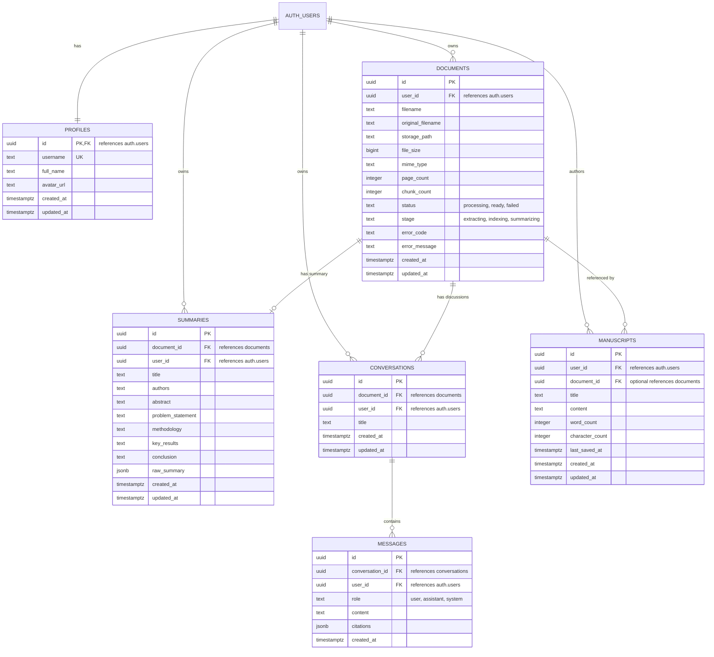

# Sophia AI — Supabase Database Schema

## Overview

The Sophia AI database on Supabase consists of 6 core application tables integrated with `auth.users`:

1. `profiles`: User account details, username, full name, avatar.
2. `documents`: Research paper records, processing stage, storage path, file size.
3. `summaries`: Generated structured summaries (Abstract, Problem, Methodology, Results, Conclusion).
4. `conversations`: Research Q&A discussion sessions.
5. `messages`: Turn-by-turn question answering and assistant responses with citations.
6. `manuscripts`: AI Writer research drafts with title, word count, character count, and content.

---

## Entity Relationship Diagram

---

## Migration Scripts

- Migration script 1: [001_initial_supabase_schema.sql](file:///c:/Users/menak/Open%20source/Sophia_AI/sophia_ai/backend/supabase/migrations/001_initial_supabase_schema.sql)
- Migration script 2: [002_rls_and_storage.sql](file:///c:/Users/menak/Open%20source/Sophia_AI/sophia_ai/backend/supabase/migrations/002_rls_and_storage.sql)

